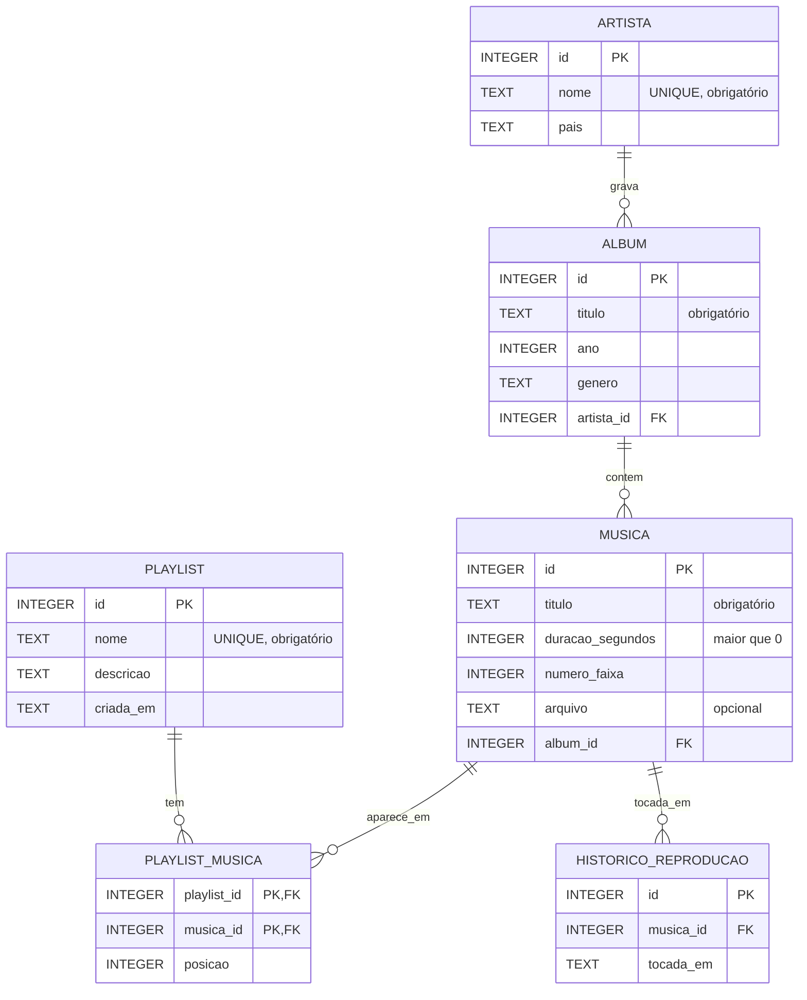

# Toca Aí: player e gerenciador de músicas no terminal

Aplicação em **Python**, feita com **Orientação a Objetos** e banco **SQLite3**, que organiza uma
biblioteca de músicas (artistas, álbuns, músicas e playlists) e **toca as músicas** no terminal, com
pausa, próxima, anterior, modo aleatório, repetição, histórico e ranking de mais tocadas.

Atividade Avaliativa 04 de Programação Orientada a Objetos (ADS, 2º semestre, IFSP Bragança Paulista).
Autor: Miguel ([@miguelvzs](https://github.com/miguelvzs)).

```text
================================================================
  TOCA AÍ  |  Player
================================================================

  Fila: Playlist "Seminário de POO"  (faixa 1 de 4)

  >> Tocando:  Self Sem Underscore
              Os Bits Errantes - Commit Final
              [=========>--------------------] 0:04 / 0:13

  Próxima: Herança Múltipla - DJ Hertz
  Aleatório: desligado  |  Repetir: desligado  |  Som: winsound (Windows, biblioteca padrão)

  1 - Pausar
  2 - Próxima
  3 - Anterior
  4 - Parar
  5 - Ligar o modo aleatório
  6 - Repetir: desligado > fila > faixa
  7 - Ver a fila (e pular para uma música)
  8 - Ouvir ao vivo (barra animada, Ctrl+C volta)
  9 - Escolher o que tocar
  0 - Voltar
```

## O que ele faz

- **Cadastro completo (CRUD)** de artistas, álbuns, músicas e playlists: listar, cadastrar, ver
  detalhes, editar e excluir.
- **Playlists**: adicionar músicas, remover, mudar a posição, tocar.
- **Busca** por título, artista, álbum ou gênero.
- **Player**: tocar, pausar/continuar, parar, próxima, anterior, modo aleatório, repetir (fila ou
  faixa), fila a partir de todas as músicas, de um álbum, de um artista, de uma playlist ou das mais
  tocadas, e o modo **ouvir ao vivo**, com a barra de progresso andando e a fila seguindo sozinha.
- **Histórico e relatórios**: 10 mais tocadas, artistas mais ouvidos, últimas reproduções, resumo da
  biblioteca e exportação de um relatório para arquivo `.txt`.
- **Som de verdade** no Windows sem instalar nada (módulo `winsound`) ou com o `pygame`, se estiver
  instalado. Sem nenhum dos dois, a reprodução é **simulada**: o tempo e a barra andam normalmente,
  só não sai som.
- **Músicas de demonstração geradas pelo próprio programa**: na primeira execução ele "compõe" 12
  melodias curtas e grava em `.wav` usando só `math`, `struct` e `wave`. Todos os artistas, álbuns e
  músicas de exemplo são **fictícios**; não há nenhuma música com direitos autorais no repositório.

## Como instalar e rodar

Precisa do **Python 3.10 ou mais novo** (testado no 3.12 e no 3.14). Não precisa instalar nenhuma
biblioteca.

```bash
git clone https://github.com/miguelvzs/player-musicas-terminal.git
cd player-musicas-terminal
python main.py
```

No Windows também funciona com `py main.py`. No Linux, se `python` não existir, use `python3 main.py`.

Na primeira execução o programa cria a pasta `dados/` com o banco `player.db`, as tabelas (pelo
script `banco/schema.sql`), os dados de exemplo e as músicas de demonstração. Leva alguns segundos
uma única vez.

### Opções

| Comando | O que faz |
|---|---|
| `python main.py` | Abre o programa normalmente |
| `python main.py --sem-som` | Não emite som (reprodução simulada) |
| `python main.py --banco=outro.db` | Usa outro arquivo de banco |
| `python main.py --ajuda` | Mostra as opções |

- Para **sair**, use a opção `0` do menu principal. **Ctrl+C** também sai, com uma mensagem, sem
  quebrar. Dentro do modo "ouvir ao vivo", Ctrl+C só volta para o menu do player.
- Para **começar do zero**, feche o programa e apague a pasta `dados/`.

### Som opcional com pygame

```bash
pip install pygame
```

Com o `pygame` instalado, o programa usa ele automaticamente (pausa de verdade e suporte a `.mp3` e
`.ogg`). Se ele não estiver instalado ou o computador não tiver saída de som, o programa segue sem
erro com a próxima opção.

## Bibliotecas

| Biblioteca | Tipo | Para quê |
|---|---|---|
| `sqlite3` | padrão | Banco de dados (conexão, cursor, `execute` com `?`, `commit`, `rollback`, `fetchall`, `fetchone`) |
| `os`, `sys` | padrão | Caminhos de arquivos e pastas, opções da linha de comando |
| `datetime` | padrão | Data e hora do histórico, das playlists e do relatório |
| `random` | padrão | Modo aleatório (`random.shuffle`) |
| `time` | padrão | Relógio do player e animação da barra |
| `math`, `struct`, `wave` | padrão | Gerar e ler as músicas `.wav` de demonstração |
| `tempfile` | padrão | Arquivo temporário para continuar depois da pausa (winsound) |
| `winsound` | padrão (só Windows) | Tocar `.wav` de verdade |
| `unittest`, `subprocess`, `io`, `contextlib`, `shutil` | padrão | Testes automáticos |
| `pygame` | **opcional** (`pip install pygame`) | Tocar som em qualquer sistema, com pausa real |

## Estrutura de pastas

```text
player-musicas-terminal/
├── main.py                      ponto de entrada: abre o banco, cria tabelas, dados de exemplo, menu
├── requirements.txt             nada obrigatório; pygame opcional
├── banco/
│   ├── schema.sql               script de criação das 6 tabelas
│   ├── conexao.py               classe Banco (connect, PRAGMA, execute, commit, rollback, close)
│   └── dados_exemplo.py         dados fictícios do primeiro uso
├── modelos/                     classes que representam os dados
│   ├── entidade.py              Entidade: classe-mãe com o id
│   ├── artista.py, album.py, musica.py, playlist.py, reproducao.py
├── repositorios/                CRUD no banco
│   ├── base.py                  RepositorioBase: INSERT/SELECT/UPDATE/DELETE escritos uma vez só
│   ├── artista_repositorio.py, album_repositorio.py, musica_repositorio.py
│   ├── playlist_repositorio.py  inclui adicionar/remover/mover músicas (tabela N:N)
│   └── historico_repositorio.py histórico e rankings (COUNT + GROUP BY)
├── audio/
│   ├── player.py                Player: fila, tocar, pausar, próxima, aleatório, repetir
│   ├── saidas.py                SaidaAudio (simulada), SaidaWinsound, SaidaPygame
│   └── gerador_wav.py           gera as melodias .wav de demonstração
├── interface/                   tudo o que aparece no terminal
│   ├── aplicacao.py             Aplicacao: junta banco, repositórios, player e menus
│   ├── menu_base.py             MenuBase: laço de menu escrito uma vez só
│   ├── menu_principal.py, menu_player.py, menu_musicas.py, menu_albuns.py,
│   ├── menu_artistas.py, menu_playlists.py, menu_relatorios.py
│   └── listagens.py             tabelas de artistas, álbuns, músicas e playlists
├── utils/
│   ├── entrada.py               leitura do teclado com validação (try/except)
│   ├── tela.py                  cores, títulos, tabelas, barra de progresso
│   └── tempo.py                 segundos <-> "m:ss"
├── testes/                      testes com unittest e o roteiro de execução
└── docs/                        contexto do projeto e guia do seminário
```

A pasta `dados/` (banco, músicas geradas e relatórios) é criada pelo programa e fica fora do Git.

## Banco de dados

Seis tabelas, com chaves estrangeiras ligadas (`PRAGMA foreign_keys = ON`). O script completo está
em [`banco/schema.sql`](banco/schema.sql).



Mesmo diagrama em texto:

```text
artista 1 ───< N album 1 ───< N musica 1 ───< N historico_reproducao
                                   1
                                   │
                                   N
                            playlist_musica   (chave: playlist_id + musica_id; guarda a posição)
                                   N
                                   │
                                   1
                                playlist
```

| Tabela | Guarda | Regras |
|---|---|---|
| `artista` | Quem canta ou toca | Nome obrigatório e único |
| `album` | Álbuns, cada um de um artista (1:N) | Não dá para excluir um artista que ainda tem álbuns |
| `musica` | Faixas, cada uma de um álbum (1:N) | Duração > 0 (`CHECK`); não dá para excluir um álbum que ainda tem músicas |
| `playlist` | Listas montadas pelo usuário | Nome obrigatório e único |
| `playlist_musica` | Ligação N:N entre playlist e música, com a posição | A mesma música não entra duas vezes na mesma playlist; excluir a playlist ou a música apaga o item (`ON DELETE CASCADE`) |
| `historico_reproducao` | Cada vez que uma música começou a tocar | Base do ranking; excluir a música apaga o histórico dela (`ON DELETE CASCADE`) |

## Orientação a Objetos no projeto

| Conceito (aula) | Onde está |
|---|---|
| Classe, `__init__`, `self`, instância | Todos os arquivos de `modelos/`, `repositorios/`, `audio/` e `interface/` |
| Atributo com valor padrão | `Playlist.__musicas = []`, `Player.__estado = PARADO`, `Album(..., ano=None, genero="")` |
| Método que valida | `Musica.set_duracao()`, `Album.set_ano()`, `Artista.set_nome()` (lançam `ValueError`) |
| Encapsulamento `_` e `__` com get/set | `Entidade._id` (fracamente privado); `Artista.__nome`, `Musica.__duracao`, `Banco.__conexao`, `Player.__fila` (fortemente privados) |
| `__str__` e `__repr__` | `__str__` em todos os modelos; `__repr__` em `Entidade` (ex.: `<Artista id=3>`) |
| Herança com `super().__init__()` | `Artista(Entidade)` e demais modelos; `ArtistaRepositorio(RepositorioBase)` e demais; `MenuArtistas(MenuBase)` e demais; `SaidaWinsound(SaidaAudio)`, `SaidaPygame(SaidaAudio)` |
| Sobrescrita e polimorfismo | `para_tupla()`/`para_objeto()` em cada repositório; `opcoes()` em cada menu; `tocar()`/`pausar()`/`parar()` em cada saída de áudio; `__str__` em cada modelo |
| Associação (instância como atributo) | `Album` tem um `Artista`; `Musica` tem um `Album`; `Playlist` tem uma lista de `Musica`; `Player` tem uma `SaidaAudio` e o repositório de histórico; cada repositório tem um `Banco` |
| Módulos e pacotes (`__init__.py`, `import`) | Pastas `banco`, `modelos`, `repositorios`, `audio`, `interface`, `utils` |

## Como cada requisito do enunciado foi atendido

| Requisito | Como foi atendido |
|---|---|
| Python com Orientação a Objetos, terminal integrado ao SQLite3 | Todo o código está em classes (tabela acima); o terminal conversa com o banco pelos repositórios |
| Menu com entrada e saída, sem erros ou interrupções abruptas | `interface/menu_principal.py` (opção 0 com confirmação); `utils/entrada.py` repete a pergunta até a resposta ser válida; `MenuBase.executar_acao()` trata `ValueError` e `sqlite3.Error`; `main.py` trata Ctrl+C, fim da entrada e erros de banco e arquivo, e sempre fecha o banco no `finally` |
| Banco com no mínimo 4 tabelas relacionais | 6 tabelas com chaves estrangeiras de verdade, incluindo uma N:N (`banco/schema.sql`) |
| CRUD conforme a necessidade | Artistas, álbuns, músicas e playlists com criar, listar, editar e excluir; itens da playlist com adicionar, listar, mover e remover; histórico com registrar, listar e limpar |
| Responsabilidades separadas em arquivos/módulos | 6 pacotes: `banco`, `modelos`, `repositorios`, `audio`, `interface`, `utils` |
| Criatividade | Player com som de verdade sem instalar nada, músicas geradas por código, modo ouvir ao vivo, ranking |
| GitHub + README com instruções e bibliotecas | Este arquivo |

## Testes

Na pasta do projeto:

```bash
python -m unittest -v
```

São 60 testes (`unittest`, biblioteca padrão), cada um com um banco temporário que é apagado no fim:

- `testes/test_repositorios.py`: CRUD de todas as tabelas, chaves estrangeiras bloqueando exclusões,
  `UNIQUE`, `CHECK`, `ON DELETE CASCADE`, busca, ranking e proteção contra SQL injection.
- `testes/test_modelos.py`: validações, associação, encapsulamento e `__str__`.
- `testes/test_player.py`: tocar, pausar, próxima, anterior, fim da fila, aleatório, repetir e o
  gerador de `.wav`.
- `testes/test_aplicacao.py`: roda o programa de verdade digitando as respostas do roteiro
  `testes/roteiro_completo.txt` (passa por todas as opções de todos os menus, com entradas erradas no
  meio) e confere que ele termina sem nenhum `Traceback`; testa também Ctrl+C e entrada que acaba no
  meio.

Para ver o roteiro rodando: `python -m testes.roteiro`.

## Limitações conhecidas

- Sem threads (não vistas na disciplina), o player não troca de faixa enquanto o programa espera uma
  digitação no menu: ele confere o relógio a cada interação. No modo **ouvir ao vivo** a fila segue
  sozinha.
- O `winsound` só toca `.wav`. Outros formatos tocam com o `pygame` ou ficam em modo simulado.
- No Linux e no Mac, sem o `pygame`, a reprodução é simulada.
